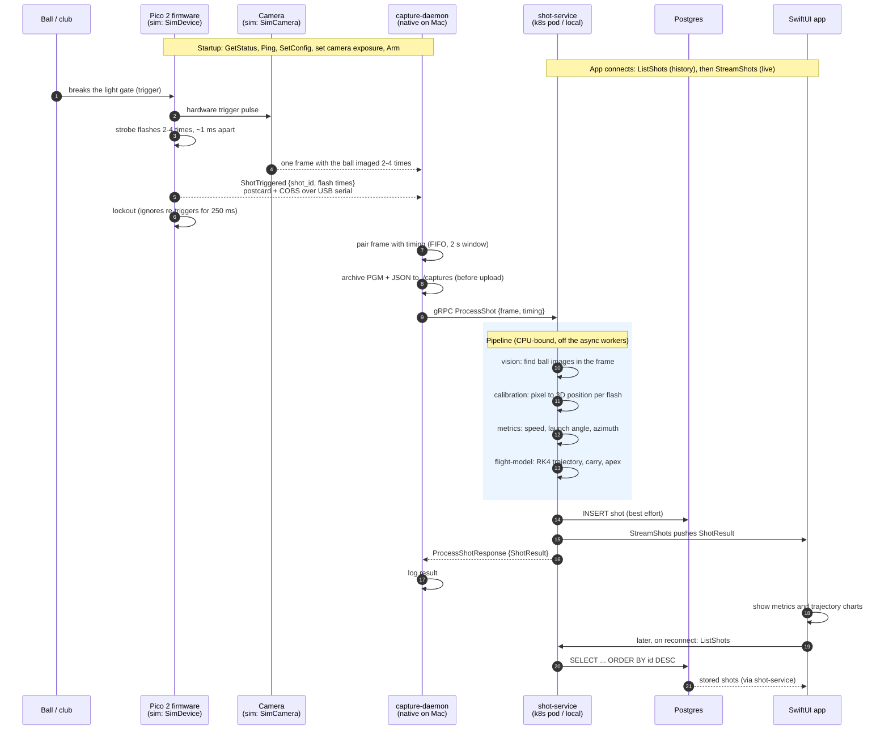

# Life of a shot

One swing, traced through every component. Mermaid renders on GitHub and in
editors with a Mermaid preview.

> Hardware status: the firmware has never run on a Pico and there is no real
> camera backend. Today `capture-daemon --mcu sim --camera sim` stands in for
> steps 1-5; everything from `ProcessShot` onward is the real code path.

## Sequence

## Where each step lives

| # | Step | Code |
|---|---|---|
| 1-4 | Arm, trigger, strobe schedule, lockout | `crates/firmware-core` (`Sequencer`), `firmware/` (Pico glue), `crates/protocol` (messages) |
| 5 | Frame and flash timing leave the device | `crates/capture-daemon` (`link`, `camera`) |
| 6-8 | Pair, archive, upload with retry | `crates/capture-daemon` (`pairing`, `daemon`, `service`), `crates/capture-store` |
| 9 | Request handling | `crates/shot-service` (`ShotSvc::process_shot`), contract in `crates/launch-proto/proto` |
| 10 | Ball detection | `crates/vision` |
| 11 | 3D position | `crates/calibration` |
| 12 | Launch conditions | `crates/metrics` |
| 13 | Trajectory | `crates/flight-model` |
| 14 | Orchestration of 10-13 | `crates/launch-core` (`Pipeline`) |
| 15 | Persistence | `crates/shot-service` (`store`, `migrations/`) |
| 16 | Live push to the app | `StreamShots` broadcast channel in `shot-service` |
| 20-22 | History | `ShotService.ListShots` |
| 19 | UI | `app/LaunchMonitor` |

## Failure behavior along the way

| Failure | Result |
|---|---|
| Frame arrives with no timing, or timing with no frame, for 2 s | The daemon drops the unmatched half. |
| `ProcessShot` fails transiently (service restarting) | The daemon retries. The capture is already archived, so `lm-replay frame ./captures` can replay it later. |
| Ball image count does not match flash count | `FAILED_PRECONDITION`; nothing is stored or streamed. |
| Postgres is down | The shot is still returned and streamed. Storing fails with a logged error, and `ListShots` returns `UNAVAILABLE`. |
| The app is closed during the shot | It missed the live push but loads the stored shot from `ListShots` next time. |
